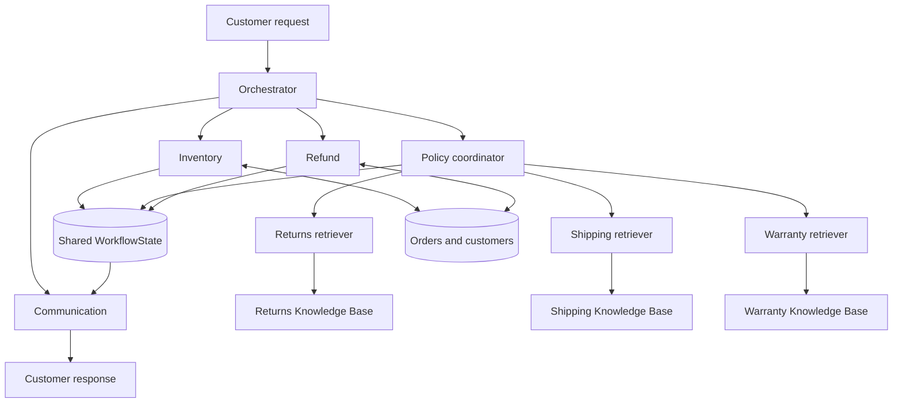
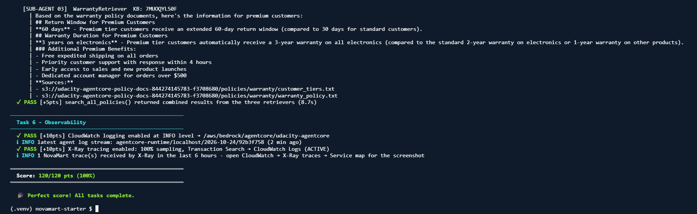
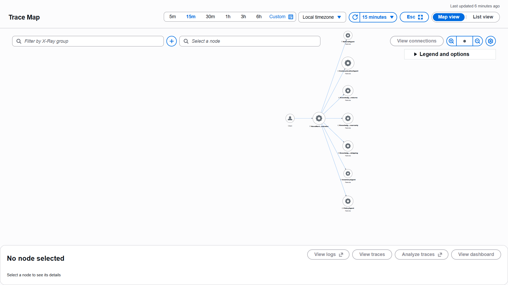
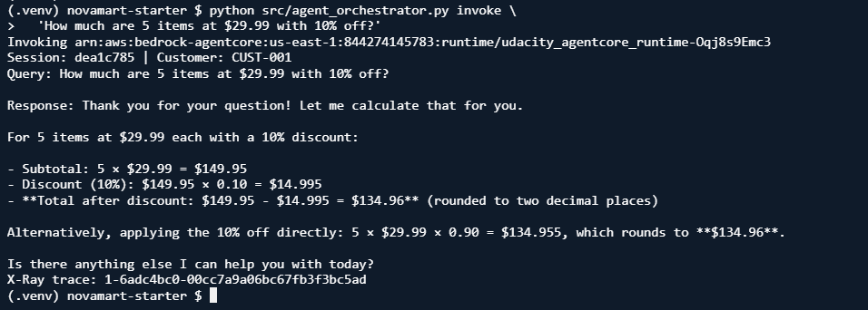

# NovaMart: Multi-Agent E-commerce RAG

An educational customer support system built with **Amazon Bedrock AgentCore**, the **Strands Agents SDK**, DynamoDB, and three Bedrock Knowledge Bases backed by S3 Vectors.

By Muhammad Waqas. Based on the [Udacity AgentCore classroom project](https://github.com/udacity/cd14764-aws-agentic-c3-classroom/tree/main/project).

## What it does

- Routes customer requests to Inventory, Policy, Refund, and Communication workers.
- Retrieves returns, shipping, and warranty policies through three retriever agents in parallel.
- Shares worker findings through DynamoDB WorkflowState with optimistic locking.
- Applies Standard (30-day) and Premium (60-day) return windows to verified order facts.
- Uses a numbered Bedrock Guardrail version for content, PII, denied topics, and profanity.
- Deploys through the AgentCore CLI and emits CloudWatch logs and X-Ray traces.

## Architecture



The three policy retrievers run with `ThreadPoolExecutor(max_workers=3)` and `as_completed()`. Workers are Strands agents inside one application, rather than separately deployed runtimes.

| Agent | Configured model | Temperature | Purpose |
|---|---|---:|---|
| Orchestrator | `config.ORCHESTRATOR_MODEL_ID` | 0.0 | Initialize and route |
| Inventory | `config.WORKER_MODEL_ID` | 0.1 | Gather customer and order facts |
| Refund | `config.WORKER_MODEL_ID` | 0.1 | Evaluate return eligibility |
| Policy coordinator | `config.WORKER_MODEL_ID` | 0.2 | Synthesize retrieved policy evidence |
| Three policy retrievers | `config.WORKER_MODEL_ID` | 0.0 | Retrieve each policy domain |
| Communication | `config.WORKER_MODEL_ID` | 0.3 | Compose the final reply |

## Start here

Prerequisites: Python 3.12+, authenticated AWS CLI, Node.js 20+, `uv`, access to the configured Bedrock models, and permission to provision the project resources in `us-east-1`. AWS resources and model calls incur charges.

```bash
git clone https://github.com/mwqas/Multi-Agent-E-commerce-RAG.git
cd Multi-Agent-E-commerce-RAG
python -m venv .venv
source .venv/bin/activate
# Windows PowerShell: .\.venv\Scripts\Activate.ps1
pip install -r requirements-dev.txt
npm install -g @aws/agentcore@0.30.0
pip install uv
cp .env.example .env
aws sts get-caller-identity
```

### 1. Provision and seed the foundation

```bash
aws cloudformation deploy \
  --template-file infrastructure/starter_stack.yaml \
  --stack-name udacity-agentcore \
  --capabilities CAPABILITY_NAMED_IAM \
  --region us-east-1
python infrastructure/seed_data.py
python config.py
```

### 2. Create and sync the Knowledge Bases

In Bedrock Console, create three **self-managed Knowledge Bases** using Titan Embed Text v2 (`amazon.titan-embed-text-v2:0`). Use the foundation stack's existing S3 Vectors bucket and matching indexes.

| Domain | S3 prefix | Existing vector index | `.env` key |
|---|---|---|---|
| Returns | `policies/returns/` | `returns-policy-index` | `RETURNS_KB_ID` |
| Shipping | `policies/shipping/` | `shipping-policy-index` | `SHIPPING_KB_ID` |
| Warranty | `policies/warranty/` | `warranty-policy-index` | `WARRANTY_KB_ID` |

Sync every data source and enter your KB IDs in your local `.env`. Model access and Marketplace prerequisites must also be satisfied for the account.

### 3. Test locally, deploy, and verify

```bash
pythontests/test_agent.py task2
pythontests/test_agent.py task5
python src/agent_orchestrator.py test
python src/agent_orchestrator.py deploy
python src/agent_orchestrator.py invoke
pythontests/test_agent.py all
```

The deploy helper creates the guardrail, deploys the runtime, provisions Memory, and configures observability. Keep the generated runtime ARN and numbered guardrail version in your local `.env`. Deployment uses the supplied CLI helper, not a direct `create_agent_runtime()` SDK call.

For interactive exploration:

```bash
python src/agent_orchestrator.py chat
python src/demo.py
```

## Recorded results

The following screenshots are evidence from the completed CloudShell/AWS project run on October 24, 2026. They are historical evidence, not a fresh live test of this GitHub checkout.





The map shows the Orchestrator, worker agents, and Knowledge Base nodes. Its aggregate layout does not by itself establish nested Policy-to-Knowledge-Base span parentage; inspect individual traces to verify timing and nesting.



## Learning materials

- [19-page learning workbook](docs/NovaMart_AgentCore_Learning_Workbook.pdf): 3D-style architecture, tools, labs, screenshots, debugging, and practice questions.
- [Step-by-step lab guide](docs/LAB_GUIDE.md)
- [Validation and source provenance](docs/VALIDATION.md)
- [Original classroom instructions](docs/CLASSROOM_README.md)

## Important implementation boundaries

- Memory provisioning creates a seven-day session-summary resource; this alone does **not** demonstrate persistent conversation event ingestion or retrieval.
- Refund handling records a return workflow decision. It does not transfer money through a payment processor. Missing delivery evidence requires review rather than an invented delivery date.
- Monetary prompts retain intermediate precision and round the final amount: `5 × 29.99 × 0.90 = 134.955 → $134.96`. Production money calculations should use a deterministic Decimal tool; the current fix is a model instruction.
- The demo supplies a customer identity. A production system needs authenticated identity and authorization before access to orders or refunds.
- This is a course implementation with recorded rubric success. Production readiness also requires security review, durable memory integration, idempotent payment processing, and operational testing.

## Repository layout

```text
src/                  Agent implementation and supplied runtime helpers
infrastructure/       Foundation template, seeding, cleanup
agentcore/            CLI and CDK deployment configuration
tests/               Classroom rubric tests and offline checks
config.py             CloudFormation exports and local configuration
.env.example          Blank environment template
docs/                Workbook, lab guide, screenshots, provenance
```

## Configuration and cleanup

Do not commit `.env`, AWS credentials, deployment state, or account-specific targets. The populated `.env` required for the course belongs in the private submission package, separate from this public repository.

After submission and when the resources are no longer needed:

```bash
python infrastructure/cleanup.py
# Inspect the dry-run output before deleting:
python infrastructure/cleanup.py --yes
```

## Attribution

The starter framework, infrastructure, helper modules, and rubric tests originate from the linked Udacity classroom project. Completed agent logic and learning documentation were prepared for this project. No new license is asserted over upstream classroom materials.
